<!-- Generated by Suite Builder. EDIT RULES: do not edit this file; regenerating replaces all of it. Your own notes on the site go in ai/AI-README.md. Creator: https://github.com/ghost-in-the-kernel -->
# The site's shape

https://www.stord.com as the crawl saw it: each box a kind of page (its class and address), each arrow a link
between them. A solid arrow is followed by a navigation test; a dotted one is not, and why is below.
Navigation tests follow 13 of 77 transitions (coverage: transitions);
every kind of page is opened by its smoke test, 32 of 32.

```mermaid
flowchart LR
  n0["HomePage<br/>/"]
  n1["ResourcesPage<br/>/resources"]
  n2["ECommerceFulfillmentPage<br/>/*"]
  n3["SolutionPage<br/>/solution"]
  n4["FulfillmentPage<br/>/fulfillment"]
  n5["ParcelPage<br/>/parcel"]
  n6["LabsPage<br/>/labs"]
  n7["CasestudyStordOnboardingPage<br/>/casestudy/stord-onboarding-for-peak-design"]
  n8["LocationsPage<br/>/locations"]
  n9["AiPage<br/>/ai"]
  n10["CasestudyHowTheZeroPage<br/>/casestudy/how-the-zero-proof-powers-growth-with-stord"]
  n11["OrderManagementSystemListPage<br/>/order-management-system"]
  n12["GetstordReferralProgramPage<br/>/getstord/referral-program"]
  n13["ExpirationPage<br/>/expiration"]
  n14["ReturnsPage<br/>/returns"]
  n15["WarehouseManagementSystemPage<br/>/warehouse-management-system"]
  n16["GetstordPage<br/>/getstord/*"]
  n17["OrderManagementSystemPage<br/>/order-management-system/*"]
  n18["CasestudyHowJolieGrewPage<br/>/casestudy/how-jolie-grew-revenue-6x"]
  n19["SeekToActionPage<br/>/*/*"]
  n20["LegalPage<br/>/legal/*"]
  n21["UnboxPage<br/>/unbox"]
  n22["ShipmentProtectionPage<br/>/shipment-protection"]
  n23["IntegrationsPage<br/>/integrations"]
  n24["IndustriesB2bPage<br/>/industries/b2b"]
  n25["NewsroomPage<br/>/newsroom/*"]
  n26["BlogPage<br/>/blog/*"]
  n27["ReportsStateOfAiPage<br/>/reports/state-of-ai-2026"]
  n28["ReportPage<br/>/reports/*"]
  n29["TransportationRetailDeliveryPage<br/>/transportation/retail-delivery-consolidation"]
  n30["ConsumerExperienceEstimatedDeliveryPage<br/>/consumer-experience/estimated-delivery-date"]
  n31["CasestudyQuipDelightsCustomersPage<br/>/casestudy/quip-delights-customers-with-stord"]
  n32(["/cpg<br/>not read"])
  n33(["/pet-supplies<br/>not read"])
  n34(["/blog<br/>not read"])
  n35(["/casestudy<br/>not read"])
  n36(["/reports<br/>not read"])
  n37(["/newsroom<br/>not read"])
  n38(["/podcast<br/>not read"])
  n39(["/partners<br/>not read"])
  n40(["/casestudy/formulating-a-scalable-consumer-experience-for-fatty15-with-stord<br/>not read"])
  n41(["/about<br/>not read"])
  n42(["/cloud-supply-chain<br/>not read"])
  n43(["/pricing<br/>not read"])
  n44(["/careers<br/>not read"])
  n45(["/get-started<br/>not read"])
  n46(["/software-services<br/>not read"])
  n47(["/transportation<br/>not read"])
  n48(["/drayage<br/>not read"])
  n49(["/freight<br/>not read"])
  n0 --> n17
  n0 --> n19
  n1 -.-> n16
  n3 -.-> n17
  n3 -.-> n26
  n10 --> n17
  n11 -.-> n17
  n12 -.-> n16
  n15 --> n16
  n16 -.-> n16
  n19 -.-> n19
  n19 -.-> n16
  n20 --> n20
  n25 -.-> n25
  n25 --> n17
  n26 --> n26
  n26 --> n16
  n26 --> n17
  n27 -.-> n28
  n28 --> n26
  n28 --> n28
  menu{{"Header and footer: on every page"}}
  menu -.-> n3
  menu -.-> n4
  menu -.-> n19
  menu -.-> n24
  menu -.-> n5
  menu -.-> n29
  menu -.-> n6
  menu -.-> n8
  menu -.-> n7
  menu -.-> n10
  menu -.-> n9
  menu -.-> n11
  menu -.-> n17
  menu -.-> n17
  menu -.-> n17
  menu -.-> n13
  menu -.-> n14
  menu -.-> n15
  menu -.-> n17
  menu -.-> n30
  menu -.-> n21
  menu -.-> n17
  menu -.-> n22
  menu -.-> n23
  menu -.-> n2
  menu -.-> n2
  menu -.-> n32
  menu -.-> n2
  menu -.-> n33
  menu -.-> n18
  menu -.-> n25
  menu -.-> n25
  menu -.-> n34
  menu -.-> n35
  menu -.-> n36
  menu -.-> n37
  menu -.-> n38
  menu -.-> n39
  menu -.-> n12
  menu -.-> n31
  menu -.-> n26
  menu -.-> n40
  menu -.-> n27
  menu -.-> n41
  menu -.-> n42
  menu -.-> n43
  menu -.-> n44
  menu --> n45
  menu -.-> n46
  menu -.-> n47
  menu -.-> n48
  menu -.-> n49
  menu -.-> n1
  menu -.-> n20
  menu -.-> n20
  menu --> n0
```

## Not followed

- ResourcesPage to GetstordPage: hidden when the page loads (a closed menu, a carousel's other slide)
- SolutionPage to OrderManagementSystemPage: hidden when the page loads (a closed menu, a carousel's other slide)
- SolutionPage to BlogPage: hidden when the page loads (a closed menu, a carousel's other slide)
- OrderManagementSystemListPage to OrderManagementSystemPage: hidden when the page loads (a closed menu, a carousel's other slide)
- GetstordReferralProgramPage to GetstordPage: hidden when the page loads (a closed menu, a carousel's other slide)
- GetstordPage to GetstordPage: hidden when the page loads (a closed menu, a carousel's other slide)
- SeekToActionPage to SeekToActionPage: hidden when the page loads (a closed menu, a carousel's other slide)
- SeekToActionPage to GetstordPage: hidden when the page loads (a closed menu, a carousel's other slide)
- NewsroomPage to NewsroomPage: hidden when the page loads (a closed menu, a carousel's other slide)
- ReportsStateOfAiPage to ReportPage: hidden when the page loads (a closed menu, a carousel's other slide)
- HomePage to SolutionPage: in a dropdown the crawl found nothing to open: its address is asked instead
- HomePage to FulfillmentPage: in a dropdown the crawl found nothing to open: its address is asked instead
- HomePage to SeekToActionPage: in a dropdown the crawl found nothing to open: its address is asked instead
- HomePage to IndustriesB2bPage: in a dropdown the crawl found nothing to open: its address is asked instead
- HomePage to ParcelPage: in a dropdown the crawl found nothing to open: its address is asked instead
- HomePage to TransportationRetailDeliveryPage: in a dropdown the crawl found nothing to open: its address is asked instead
- HomePage to LabsPage: in a dropdown the crawl found nothing to open: its address is asked instead
- HomePage to LocationsPage: in a dropdown the crawl found nothing to open: its address is asked instead
- HomePage to CasestudyStordOnboardingPage: in a dropdown the crawl found nothing to open: its address is asked instead
- HomePage to CasestudyHowTheZeroPage: in a dropdown the crawl found nothing to open: its address is asked instead
- HomePage to AiPage: in a dropdown the crawl found nothing to open: its address is asked instead
- HomePage to OrderManagementSystemListPage: in a dropdown the crawl found nothing to open: its address is asked instead
- HomePage to OrderManagementSystemPage: in a dropdown the crawl found nothing to open: its address is asked instead
- HomePage to OrderManagementSystemPage: in a dropdown the crawl found nothing to open: its address is asked instead
- HomePage to OrderManagementSystemPage: in a dropdown the crawl found nothing to open: its address is asked instead
- HomePage to ExpirationPage: in a dropdown the crawl found nothing to open: its address is asked instead
- HomePage to ReturnsPage: in a dropdown the crawl found nothing to open: its address is asked instead
- HomePage to WarehouseManagementSystemPage: in a dropdown the crawl found nothing to open: its address is asked instead
- HomePage to OrderManagementSystemPage: in a dropdown the crawl found nothing to open: its address is asked instead
- HomePage to ConsumerExperienceEstimatedDeliveryPage: in a dropdown the crawl found nothing to open: its address is asked instead
- HomePage to UnboxPage: in a dropdown the crawl found nothing to open: its address is asked instead
- HomePage to OrderManagementSystemPage: in a dropdown the crawl found nothing to open: its address is asked instead
- HomePage to ShipmentProtectionPage: in a dropdown the crawl found nothing to open: its address is asked instead
- HomePage to IntegrationsPage: in a dropdown the crawl found nothing to open: its address is asked instead
- HomePage to ECommerceFulfillmentPage: in a dropdown the crawl found nothing to open: its address is asked instead
- HomePage to ECommerceFulfillmentPage: in a dropdown the crawl found nothing to open: its address is asked instead
- HomePage to unread:/cpg: in a dropdown the crawl found nothing to open: its address is asked instead
- HomePage to ECommerceFulfillmentPage: in a dropdown the crawl found nothing to open: its address is asked instead
- HomePage to unread:/pet-supplies: in a dropdown the crawl found nothing to open: its address is asked instead
- HomePage to CasestudyHowJolieGrewPage: in a dropdown the crawl found nothing to open: its address is asked instead
- HomePage to NewsroomPage: in a dropdown the crawl found nothing to open: its address is asked instead
- HomePage to NewsroomPage: in a dropdown the crawl found nothing to open: its address is asked instead
- HomePage to unread:/blog: in a dropdown the crawl found nothing to open: its address is asked instead
- HomePage to unread:/casestudy: in a dropdown the crawl found nothing to open: its address is asked instead
- HomePage to unread:/reports: in a dropdown the crawl found nothing to open: its address is asked instead
- HomePage to unread:/newsroom: in a dropdown the crawl found nothing to open: its address is asked instead
- HomePage to unread:/podcast: in a dropdown the crawl found nothing to open: its address is asked instead
- HomePage to unread:/partners: in a dropdown the crawl found nothing to open: its address is asked instead
- HomePage to GetstordReferralProgramPage: in a dropdown the crawl found nothing to open: its address is asked instead
- HomePage to CasestudyQuipDelightsCustomersPage: in a dropdown the crawl found nothing to open: its address is asked instead
- HomePage to BlogPage: in a dropdown the crawl found nothing to open: its address is asked instead
- HomePage to unread:/casestudy/formulating-a-scalable-consumer-experience-for-fatty15-with-stord: in a dropdown the crawl found nothing to open: its address is asked instead
- HomePage to ReportsStateOfAiPage: in a dropdown the crawl found nothing to open: its address is asked instead
- HomePage to unread:/about: in a dropdown the crawl found nothing to open: its address is asked instead
- HomePage to unread:/cloud-supply-chain: in a dropdown the crawl found nothing to open: its address is asked instead
- HomePage to unread:/pricing: in a dropdown the crawl found nothing to open: its address is asked instead
- HomePage to unread:/careers: in a dropdown the crawl found nothing to open: its address is asked instead
- HomePage to unread:/software-services: in a dropdown the crawl found nothing to open: its address is asked instead
- HomePage to unread:/transportation: in a dropdown the crawl found nothing to open: its address is asked instead
- HomePage to unread:/drayage: in a dropdown the crawl found nothing to open: its address is asked instead
- HomePage to unread:/freight: in a dropdown the crawl found nothing to open: its address is asked instead
- HomePage to ResourcesPage: in a dropdown the crawl found nothing to open: its address is asked instead
- HomePage to LegalPage: in a dropdown the crawl found nothing to open: its address is asked instead
- HomePage to LegalPage: in a dropdown the crawl found nothing to open: its address is asked instead
